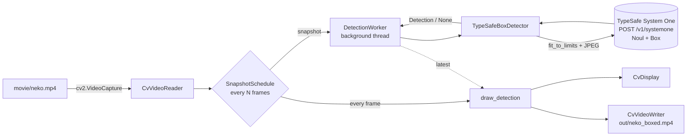

# neko-box 設計ドキュメント

TypeSafe AI System One の **Box** プリミティブ（アーリーアダプタ向け / Dreamer-ready）を試す POC。
動画を OpenCV で再生し、1 秒ごとのスナップショットについて「猫はどこですか」と System One に問い合わせ、
返ってきた位置をバウンディングボックスとして動画に重ねる。

## アーキテクチャ

| モジュール | 責務 |
|---|---|
| `geometry.py` | 値オブジェクト（new type 相当）: `NormalizedBox`（0〜1、left<right、top<bottom）、`PixelBox`、`Probability`、`Detection` |
| `frame_prep.py` | API 画像制限（各辺 280〜1568px）へのリサイズ／パディング、JPEG エンコード、パディング座標の逆写像 |
| `detector.py` | `CatDetector` Protocol と、SDK を使う `TypeSafeBoxDetector`。SDK クライアントも `SystemOneClient` Protocol で抽象化 |
| `pipeline.py` | `SnapshotSchedule`、`DetectionWorker`（非同期検出）、`run_live` / `run_offline` / `play` |
| `video_io.py` | `VideoReader` / `VideoWriter` / `Display` Protocol と OpenCV 実装 |
| `overlay.py` | 枠と `cat 96% \| box 22%` ラベルの描画 |
| `cli.py` | 引数処理、`API_KEY_JEV` 読み込み、組み立て |

外部依存（TypeSafe API、OpenCV の GUI／ファイル）はすべて Protocol 越しに注入し、ユニットテストではフェイク（`tests/fakes.py`）に差し替える。

## 主要な設計判断

### 1. Box と Noul を 1 リクエストで同時に聞く
Box は対象が写っていなくても必ず 4 辺を返す（ドキュメントに明記）。
そこで同じリクエストに Noul「この画像に猫は写っていますか？」を含め、`noul >= threshold`（既定 0.5）のときだけ枠を描く。
実測では、猫がいない場面は noul 0.04〜0.05（このとき Box は画面全体で confidence 0.02）、猫がいる場面は 0.90〜0.96 と、はっきり分かれた。

### 2. 2 つの実行モード
| モード | 動き | 用途 |
|---|---|---|
| `live`（既定） | 再生しながら `DetectionWorker` スレッドで非同期に検出する。最新の結果を、次の結果が来るまで重ねる | デモ、体感確認 |
| `offline` | スナップショットごとに同期で検出し、ずれのない注釈付き mp4 を書き出したあと再生する | LinkedIn 投稿用の動画 |

`DetectionWorker` の待ち行列は 1 枠だけ持つ。API が詰まったら古い未処理スナップショットを捨てて最新のものを優先するので、再生は決してブロックされない。

### 3. 画像制限への対応
API は制限外の画像を拒否する（リサイズしない）。そのため送信前に長辺 ≤1568、短辺 ≥280 に収める。
極端な縦横比で両方を満たせない場合は、右下にパディングし、返ってきた正規化座標を元フレーム基準に戻す（`PreparedFrame.to_original`）。

### 4. 複数匹モード（`--max-cats N`）：数える＋塗りつぶし
Box は 1 つの質問につき枠を 1 つしか返さない。`many_cats.mp4` で次の 3 つを試した。

| 方式 | 結果 |
|---|---|
| 順番を指定（「左から k 番目の猫」、英語の "the 2nd cat from the left" も） | ❌ 何番目と聞いても、ほぼ同じ（一番目立つ）猫を返す |
| 柄ごとに聞く（茶トラ／黒猫／三毛…） | △ 有無は正しいが、並んだ猫の枠が 1 匹に重なることがある。柄を事前に知る必要もある |
| 見つけた猫を塗りつぶして聞き直す | ◎ 並んだ 3 匹がきれいに分かれる。ただし塗り残しを余分な猫と答えることがある |

そこで次の組み合わせにした。
1. 1 回目のリクエストで、Noul「猫が少なくとも k 匹写っていますか？」（k = 1..N）と Box「1匹の猫」を同時に聞く。Noul が最初に「いいえ」になったところで打ち切り、**匹数を確定**する（4 フレームの検証で匹数は全問正解）
2. 見つけた猫の枠をグレーで塗りつぶし、Box「1匹の猫」だけを聞き直す。これを**確定した匹数まで**繰り返す → 塗り残しによる余分な検出を防ぐ
3. 前の枠と IoU ≥ 0.7 の枠が返ったら、新しい猫は見つからなかったとみなして打ち切る

`cat#k` は k 番目に見つけた猫で、表示する確率は「少なくとも k 匹いる」確率。リクエストは猫の数だけ順番に送る（3 匹で約 0.6〜0.9 秒）。

**プロンプトの単数／複数が効く**：日本語の「猫はどこですか」は単数か複数かがあいまいで、Box が**猫の群れ全体**を 1 つの枠で囲み、confidence も 0.09〜0.17 まで下がった。「1匹の猫」（または英語の "A cat"）と単数をはっきり言うと、1 匹分の幅になり confidence も 0.4〜0.8 に上がった。そのため複数匹モードは「1匹の猫」で聞く（`--prompt` は 1 匹モード専用）。

### 5. 失敗に強い再生
API エラー（429/5xx、検証エラー、不正な座標）は `DetectionError` にまとめ、ログを出してそのスナップショットを「猫なし」として扱う。再生と書き出しは続ける。SDK 自体も 429/529 を指数バックオフでリトライする。

## 実測結果（movie/neko.mp4、1280x720、24fps、10 秒）
- 1 リクエストあたり 150〜250ms、約 2,700 入力トークン
- スナップショットの box は猫の位置とよく一致する（覗き込み、カーテン越し、画面いっぱいの顔を含む）
- Box の confidence は 0.2〜0.4 と低め（Dreamer-ready 段階）。枠の位置の確かさを表す値と考えられ、見た目の精度とはあまり連動しない。ラベルは `cat <Noul 確率> | box <Box confidence>` と両方を出す
- 猫の動きが速いため、1 秒間 box を保持すると途中でずれる → `--interval 0.5` を推奨

## 実測結果（movie/many_cats.mp4、柄の違う猫が最大 3 匹、`--max-cats 5`）
- 横に並んだ 3 匹（frame 96）、立っている 2 匹（frame 144）、手前の猫の奥にいる黒猫（frame 216）を、別々の枠で検出できた
- 苦手な場面：縦に重なって顔を出す 3 匹で 1 匹しか取れない（frame 72）。体が重なった猫で、枠が 2 匹にまたがる（frame 168、192）
- 枠が 2 匹にまたがったときは、Box の confidence が 0.13〜0.17 と低かった。単数で聞く複数匹モードでは、confidence が位置のあいまいさの目安として役に立ちそう
- 1 匹だけの `neko.mp4` に複数匹モードを使うと、画面いっぱいに映ったぼやけた猫（frame 192）を 2 匹と数えることがあった（Noul 0.81）

## セキュリティ
- API キーは環境変数 `API_KEY_JEV`（または git 管理外の `.env`）からのみ読む。コードとログには出さない（SDK は Authorization を `***` でマスクする）
- 依存は `pip-audit` で検査済み（既知の脆弱性なし）。`httpx2` / `httpcore2` は typesafe-sdk が依存する pydantic 公式の HTTP クライアント
- 送信するのは動画フレームの JPEG だけ（EXIF なし）

## 品質
- ユニットテスト 70 件、カバレッジ 100%（GUI 表示と SDK の接続部分は `pragma: no cover`）。レポート: `docs/coverage/index.html`
- 統合テスト: `uv run pytest -m integration`（本物の API を呼ぶので `API_KEY_JEV` が必要）
- Ruff（E/F/W/I/B/UP/N/S/SIM/RUF/PL/PT/C4）違反ゼロ、`ruff format` 適用済み
